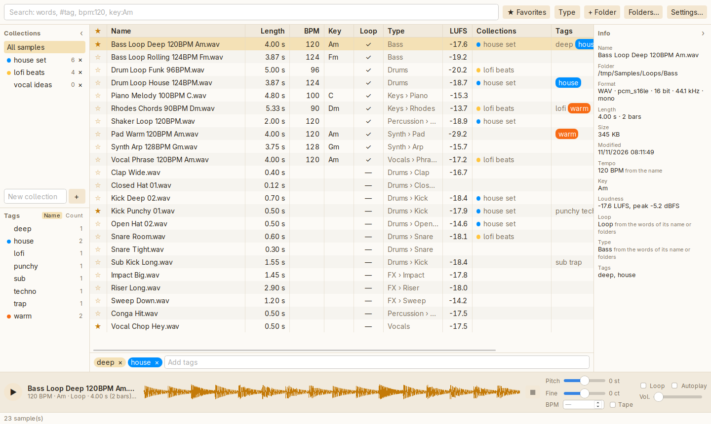

[](https://github.com/nd-/samplr/actions/workflows/tests.yml)

# samplr (WIP)

Audio sample manager for Linux and macOS (and Windows, maybe, someday).  
Scan sample folders, tag them, find them again and listen to them.



## What it does

samplr is for musicians whose sample packs pile up on their disks: it finds a sound again, lets you hear it at once, and drags it into your DAW.

- **Your folders, as they are.** Point samplr at your sample folders: it indexes them and follows them live. Your files never move unless you ask, so your DAW projects keep finding them, and an unplugged disk loses nothing.
- **Worked out from your samples.** Tempo and key from the file names and the WAV files' ACID chunk, loop or one-shot, the kind of sound (Drums › Kick, Bass, Keys…), the length in bars and the loudness.
- **Found in one search box.** Words in the names or the tags, and filters such as `bpm:118-124`, `key:Am`, `loop:yes` or `type:kick`.
- **Heard right away.** The arrow keys browse and play, with the pitch and the tempo changed one without the other, to hear a loop in your track's key and tempo.
- **Sorted your way.** Tags, favorites, collections gathered by hand, and colours.
- **Used with your DAW.** Drag samples into it, rename, move, convert (WAV, AIFF, FLAC, MP3, OGG) or trash their files from samplr.

A graphical interface, and a command line (`samplr`) for scripts. Every change is listed in [CHANGELOG.md](CHANGELOG.md).

## Installation

There is no installer yet: ready-made ones will come soon, a `.dmg` for the Mac and an AppImage or a `.deb` for Linux. Until then, samplr is built from its code.

### Getting the code

```sh
git clone https://github.com/nd-/samplr.git
cd samplr
```

### Install on Linux

```sh
# 1. git, build tools and the audio output's headers (ALSA)
# Debian / Ubuntu:
sudo apt install git build-essential pkg-config libasound2-dev
# Fedora:
sudo dnf install git gcc pkg-config alsa-lib-devel

# 2. Rust (installs rustup, cargo and rustc in ~/.cargo)
curl --proto '=https' --tlsv1.2 -sSf https://sh.rustup.rs | sh

# 3. For the graphical interface only, not the command line: its web view (WebKitGTK)
# Debian / Ubuntu:
sudo apt install libwebkit2gtk-4.1-dev libgtk-3-dev libsoup-3.0-dev
# Fedora (gcc-c++ for the pitch and tempo engine, in C++):
sudo dnf install gcc-c++ webkit2gtk4.1-devel gtk3-devel libsoup3-devel javascriptcoregtk4.1-devel

# 4. Optional, to convert samples: ffmpeg
# Debian / Ubuntu:
sudo apt install ffmpeg
# Fedora (or ffmpeg, from RPM Fusion):
sudo dnf install ffmpeg-free
```

Close and reopen the terminal, then check the installation with `cargo --version`.

### Install on Mac

```sh
# 1. Apple's build tools (clang, git…)
xcode-select --install

# 2. Rust (installs rustup, cargo and rustc in ~/.cargo)
curl --proto '=https' --tlsv1.2 -sSf https://sh.rustup.rs | sh

# 3. Optional, to convert samples: ffmpeg, with Homebrew
brew install ffmpeg
```

Close and reopen the terminal. Nothing else to install: sound goes through CoreAudio and the interface through WKWebView, both built into macOS.

## Running

### The app

From the project folder:

```sh
cargo run -p samplr-app
```

The first build takes a few minutes, as every dependency is compiled once; the next ones a few seconds. At the first launch, add your sample folders with **+ Folder** (samplr also offers the Splice folders it finds). Then the arrow keys browse and play, a double-click on a cell sets a sample's tempo, key, loop or type, and **Settings…** lists every keyboard shortcut.

For an optimised build, faster on a big library: `cargo build --release -p samplr-app`, then `./target/release/samplr-app`.

### The command line

From the project folder:

```sh
cargo run -- scan ~/Samples                  # adds the folder's samples to the database
cargo run -- list                            # shows the samples in the database
cargo run -- tag ~/Samples/kick.wav kick 808 # adds tags to a sample
cargo run -- untag ~/Samples/kick.wav 808    # removes some
cargo run -- tags                            # lists the tags
cargo run -- search '#kick' hard bpm:120     # tagged kick, "hard" in the path or a tag, at 120 BPM
cargo run -- watch                           # updates the database live when scanned folders change
cargo run -- play ~/Samples/kick.wav         # plays a file
cargo run -- wave ~/Samples/kick.wav         # draws its waveform in the terminal
cargo run -- waveforms                       # computes the missing waveforms
cargo run -- similar ~/Samples/kick.wav      # the samples that sound most like it
cargo run -- help                            # every command
```

The `--` separates cargo's options from the program's. For an optimised build: `cargo build --release`, then `./target/release/samplr scan ~/Samples`.

### The library

The app and the command line share their database, created on first launch, in `~/.local/share/samplr/samplr.db` on Linux and `~/Library/Application Support/samplr/samplr.db` on Mac. To experiment on a separate database: `SAMPLR_DB=/tmp/test.db cargo run -- scan ~/Samples`.

## Contributing

How to run the tests, and what they cover: [CONTRIBUTING.md](CONTRIBUTING.md).

## Supported formats

WAV, AIFF (`.aif`, `.aiff`), FLAC, MP3, OGG, M4A.

## Credits

samplr stands on the work of others:

- [Tauri](https://github.com/tauri-apps/tauri) for the window around the interface, with its [dialog and window-state plugins](https://github.com/tauri-apps/plugins-workspace), and CrabNebula's [drag](https://github.com/crabnebula-dev/drag-rs) to drag samples into a DAW.
- [Symphonia](https://github.com/pdeljanov/Symphonia) reads and decodes the audio files, [rodio](https://github.com/RustAudio/rodio) plays them.
- [Signalsmith Stretch](https://github.com/Signalsmith-Audio/signalsmith-stretch) changes the tempo and the pitch one without the other, through the [ssstretch](https://github.com/bmisiak/ssstretch) binding.
- [ebur128](https://github.com/sdroege/ebur128) measures the loudness (EBU R128).
- [RustFFT](https://github.com/ejmahler/RustFFT), through [realfft](https://github.com/HEnquist/realfft), computes the spectra that sound alike samples are compared on.
- [SQLite](https://sqlite.org), through [rusqlite](https://github.com/rusqlite/rusqlite), keeps the library.
- [notify](https://github.com/notify-rs/notify) follows the folders, [walkdir](https://github.com/BurntSushi/walkdir) walks them, [trash](https://github.com/ArturKovacs/trash) sends files to the system's trash, and [clap](https://github.com/clap-rs/clap) reads the command line.
- [FFmpeg](https://ffmpeg.org), run as a separate program, converts samples.
- [Playwright](https://playwright.dev) drives the interface's tests, and [tauri-driver](https://github.com/tauri-apps/tauri) the real app's.

## License

samplr is licensed under either of [the MIT license](LICENSE-MIT) or [the Apache License, Version 2.0](LICENSE-APACHE), at your option.
